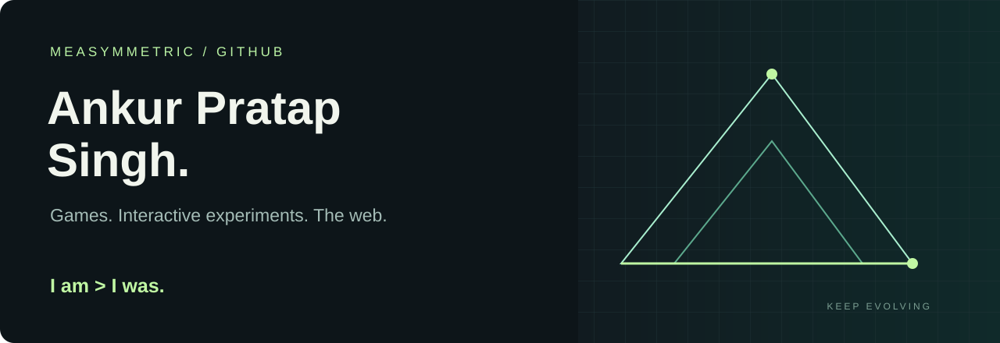

  

  <a href="https://devankur.vercel.app/"><strong>Visit my portfolio ↗</strong></a>
  &nbsp; · &nbsp;
  <a href="https://github.com/measymmetric?tab=repositories">Explore my repositories</a>

### Hey, I'm Ankur.

I build games and explore the web. My public work spans Unity and C# projects, from my first mobile game to interactive experiments.

Based in **Delhi**. Building, learning, and making the next version better.

---

### A few things I've built

<table>
<tr>
<td width="50%" valign="top">
<h3>01 / Space Attack</h3>

My first Unity game for mobile. A starting point in my journey of making playable ideas.

<code>Unity</code> <code>C#</code> <code>Mobile</code>

<a href="https://github.com/measymmetric/space-attack"><strong>Explore Space Attack →</strong></a>
</td>
<td width="50%" valign="top">
<h3>02 / Shooting Range</h3>

A C# game project. Explore the source and the work behind the experience.

<code>C#</code> <code>Game development</code>

<a href="https://github.com/measymmetric/Shooting-Range"><strong>Explore Shooting Range →</strong></a>
</td>
</tr>
<tr>
<td width="50%" valign="top">
<h3>03 / Photobooth</h3>

An interactive project in my public collection, built with C#.

<code>C#</code> <code>Interactive</code>

<a href="https://github.com/measymmetric/Photobooth"><strong>Explore Photobooth →</strong></a>
</td>
<td width="50%" valign="top">
<h3>04 / Web Developing</h3>

A collection of my web development work and experiments.

<code>Web development</code> <code>Experiments</code>

<a href="https://github.com/measymmetric/Web-Developing"><strong>Explore web projects →</strong></a>
</td>
</tr>
</table>

### The thread through it all

**Turn an idea into something you can interact with.**  
A game, an experiment, a page — each one is a chance to build something better.

   
  <strong>I am &gt; I was.</strong> 
  Keep building. Keep evolving.

